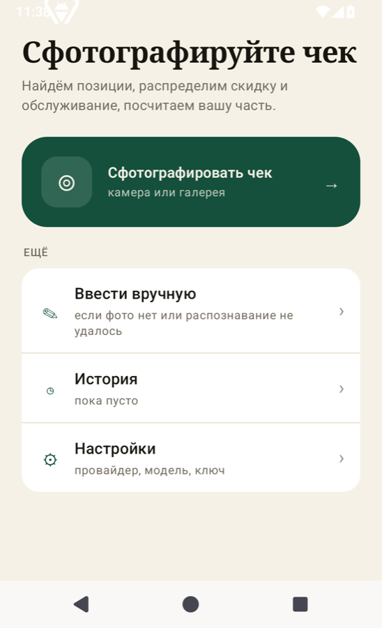

# «Расчёт по чеку» — Android



Фотографируете чек — приложение распознаёт позиции, вы отмечаете свои (и доли
общих), добавляете чаевые и видите сумму, которую нужно перевести платившему.

Сервера нет: приложение ходит к LLM-провайдеру напрямую. Ключ вводится в
настройках и хранится на телефоне в защищённом хранилище.

## Статус

MVP собран: распознавание чека, проверка и правка позиций, выбор доли, скидка и
обслуживание, чаевые, итог с шарингом, локальная история, настройки провайдера.
Готовых релизов и тегов пока нет — APK собирается из исходников.
Интерфейс и документация — на русском.

## Требования

- JDK 17
- Android SDK: platform 35, build-tools 35.0.0
- Путь к SDK — в `app/local.properties` (`sdk.dir=...`) или в `ANDROID_HOME`

## Сборка и проверки

Из корня репозитория:

```sh
make -C app check     # стиль Kotlin (ktlint) и unit-тесты
make -C app analyze   # Android lint
make -C app build     # debug APK
make -C app format    # автоформат Kotlin
```

Release-сборка:

```sh
cd app && ./gradlew assembleRelease
```

Без переменных подписи собирается
`app/build/outputs/apk/release/chekcalc-release-unsigned.apk`. Чтобы получить
подписанный APK, задайте все четыре переменные:

| Переменная | Значение |
|---|---|
| `ANDROID_KEYSTORE_PATH` | абсолютный путь к keystore |
| `ANDROID_KEYSTORE_PASSWORD` | пароль хранилища |
| `ANDROID_KEY_ALIAS` | имя ключа |
| `ANDROID_KEY_PASSWORD` | пароль ключа |

Частичный набор переменных валит сборку с объяснением. `minifyEnabled` выключен:
R8 требует проверки на устройстве, поэтому release APK больше debug.

Установка:

```sh
adb install -r app/build/outputs/apk/debug/chekcalc-debug.apk
```

## Релиз

Версия приложения — в `app/version.properties`; release-сборка проверяет
сертификат, пишет файл доказательств, ставит тег и создаёт черновик
GitHub Release. Порядок, бэкап ключа и действия при сбое —
в [docs/releasing.md](docs/releasing.md); история версий — в
[CHANGELOG.md](CHANGELOG.md).

```sh
make -C app release-check    # дерево, версия, ktlint, тесты, lint
make -C app release-verify   # SHA в main, зелёный CI, состояние тега
make -C app release-build    # подписанный APK и файл доказательств
make -C app release-draft    # тег и черновик GitHub Release
```

## Первый запуск

1. Открыть «Настройки» и выбрать провайдера: DeepSeek, OpenRouter или свой
   OpenAI-совместимый адрес.
2. Ввести API-ключ провайдера и модель, которая принимает изображения.
3. Вернуться на главный экран и сфотографировать чек.

Ключ провайдера хранится только на устройстве и не попадает в резервные копии
(`allowBackup=false`). Фото чека не сохраняется: уходит в запрос и забывается.

## Структура

```
app/src/main/java/ru/chekcalc/
  api/      клиент провайдера и разбор ответа
  calc/     расчёт доли: чистые функции без UI и сети
  image/    сжатие и ориентация фото
  model/    модель чека
  storage/  настройки, история, защищённое хранилище ключа
  ui/       экраны Compose: home, import, review, select, summary, history, settings
app/src/test/resources/golden/   эталонные чеки с разметкой

docs/spec.md          спецификация продукта
docs/spec-repo.md     оформление репозитория: правила, проверки, границы
docs/mockups/         макеты интерфейса
docs/screenshots/     снимки экранов
```

## Названия

| Где | Как называется |
|---|---|
| репозиторий | `receipt-split-calculator` |
| Gradle-проект | `chekcalc` |
| applicationId и пакет | `ru.chekcalc` |
| имя в лончере | «Расчёт по чеку» |

## Лицензия

Код распространяется по [MIT](LICENSE).

Фото эталонных чеков в `app/src/test/resources/golden/` принадлежат их авторам и
распространяются по своим лицензиям: см.
[ATTRIBUTION.md](app/src/test/resources/golden/ATTRIBUTION.md) и [NOTICE](NOTICE).
